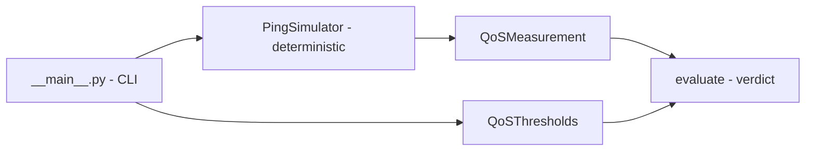

# validador-qos-voip

**English** · [Português (Brasil)](README.md)

[](#) [](#) [](LICENSE)

## What it is

A **Quality of Service (QoS) validator for VoIP** built on **deterministic simulation** (no real network): it measures latency, jitter and packet loss and compares them against configurable thresholds, returning a verdict (pass/fail). It is an educational laboratory in pure Python, with no dependencies.

## Status

An educational lab, working, with 19 tests.

> **Warning (verified by the agent):** the repository contains **committed duplicated structure** (`src/src/…` and `tests/tests/…`). Because of this, `pytest tests/` fails with an "import file mismatch" (exit 2). The **19 tests pass** when running `pytest tests/test_qos.py` directly. See `HYGIENE.md`.

## Features

- **Deterministic ping simulator** (`PingSimulator`): same parameters → same result; base latency, jitter factor, loss rate and seed.
- **Configurable QoS thresholds** (`QoSThresholds`): maximum latency, jitter and loss.
- **Evaluation** (`evaluate`): compares the measurement against the thresholds and issues a verdict.
- **CLI**: `validador-qos-voip` with flags for count, latency, jitter, loss, seed and thresholds.

## Architecture

A `validador_qos_voip` package with `qos.py` (domain: simulation, measurement, thresholds, verdict) and `__main__.py` (CLI). No backend, no external dependencies.



## Stack

- Python ≥ 3.10, stdlib only
- pytest (dev)

## Repository layout

```
validador-qos-voip/
├── pyproject.toml
├── BRIEF.md
├── src/validador_qos_voip/
│   ├── __init__.py · __main__.py · qos.py
├── tests/test_qos.py
├── (committed duplicates: src/src/…, tests/tests/…)  # see HYGIENE
└── LICENSE              # MIT
```

## Prerequisites and installation

Python ≥ 3.10.

```bash
pip install -e .
```

## How to run

```bash
# as a module
python -m validador_qos_voip --count 100 --base-latency-ms 40 --jitter-factor-ms 5 --loss-rate 0.02

# as an installed script
validador-qos-voip --seed 1
```

## Tests and quality

Real run (verified by the agent):

```bash
python -m pytest tests/test_qos.py -q
# 19 passed
```

> `pytest tests/` (the default testpaths) fails because of the committed duplicated structure — see Status above.

## Technical decisions and trade-offs

- **Deterministic simulation instead of a real network**: reproducible, safe and offline; the cost is not measuring the actual network.
- **Pure Python with no dependencies**: a light lab that runs on any machine.

## Known limitations and roadmap

- It simulates, and does not test a real network (QoS approximated by latency/jitter/loss).
- The duplicated folder structure needs cleanup for `pytest tests/` to work as expected (a proposal in `HYGIENE.md`).

## Development process

An individual project by Kelvin Oliveira, built with orchestrated AI agents and reviewed by the author. The QoS simulation and evaluation logic and the review are the author's.

## License and author

MIT — Copyright (c) 2026 Kelvin Rebelo de Oliveira.

**Author**: [Kelvin Oliveira](https://github.com/KelvinOliveiraCode) · [Portfolio](https://kelvinoliveiracode.github.io/portfolio/)
