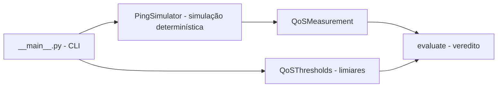

# validador-qos-voip

[English](README.en.md) · **Português (Brasil)**

[](#) [](#) [](LICENSE)

## O que é

Validador de **Qualidade de Serviço (QoS) para VoIP** por **simulação determinística** (sem rede real): mede latência, jitter e perda de pacotes e compara com limiares configuráveis, devolvendo um veredito (aprovado/reprovado). É um laboratório educacional em Python puro, sem dependências.

## Status

Laboratório educacional, funcional, com 19 testes.

> **Aviso (verificado pelo agente):** o repositório contém **estrutura duplicada commitada** (`src/src/…` e `tests/tests/…`). Por isso `pytest tests/` fallha com "import file mismatch" (exit 2). Os **19 testes passam** ao rodar `pytest tests/test_qos.py` diretamente. Ver `HYGIENE.md`.

## Funcionalidades

- **Simulador de ping determinístico** (`PingSimulator`): mesmos parâmetros → mesmo resultado; latência base, fator de jitter, taxa de perda e semente.
- **Limiares de QoS configuráveis** (`QoSThresholds`): latência, jitter e perda máximos.
- **Avaliação** (`evaluate`): compara a medição com os limiares e emite veredito.
- **CLI**: `validador-qos-voip` com flags de contagem, latência, jitter, perda, semente e limiares.

## Arquitetura

Um pacote `validador_qos_voip` com `qos.py` (domínio: simulação, medição, limiares, veredito) e `__main__.py` (CLI). Sem backend, sem dependências externas.



## Stack

- Python ≥ 3.10, stdlib apenas
- pytest (dev)

## Estrutura do repositório

```
validador-qos-voip/
├── pyproject.toml
├── BRIEF.md
├── src/validador_qos_voip/
│   ├── __init__.py · __main__.py · qos.py
├── tests/test_qos.py
├── (duplicados commitados: src/src/…, tests/tests/…)  # ver HYGIENE
└── LICENSE              # MIT
```

## Pré-requisitos e instalação

Python ≥ 3.10.

```bash
pip install -e .
```

## Como executar

```bash
# por módulo
python -m validador_qos_voip --count 100 --base-latency-ms 40 --jitter-factor-ms 5 --loss-rate 0.02

# via script instalado
validador-qos-voip --seed 1
```

## Testes e qualidade

Execução real (verificada pelo agente):

```bash
python -m pytest tests/test_qos.py -q
# 19 passed
```

> `pytest tests/` (testpaths padrão) falha por causa da estrutura duplicada commitada — ver Status acima.

## Decisões técnicas e trade-offs

- **Simulação determinística em vez de rede real**: reprodutível, segura e offline; o custo é não medir a rede de verdade.
- **Python puro sem dependências**: laboratório leve e fácil de rodar em qualquer máquina.

## Limitações conhecidas e roadmap

- Simula, não testa rede real (MQoS aproximado por latência/jitter/perda).
- A estrutura de pastas duplicada precisa ser limpa para o `pytest tests/` funcionar como esperado (proposta em `HYGIENE.md`).

## Processo de desenvolvimento

Projeto individual de Kelvin Oliveira, construído com agentes de IA orquestrados e revisado pelo autor. A lógica de simulação e avaliação de QoS e a revisão são do autor.

## Licença e autor

MIT — Copyright (c) 2026 Kelvin Rebelo de Oliveira.

**Autor**: [Kelvin Oliveira](https://github.com/KelvinOliveiraCode) · [Portfólio](https://kelvinoliveiracode.github.io/portfolio/)
